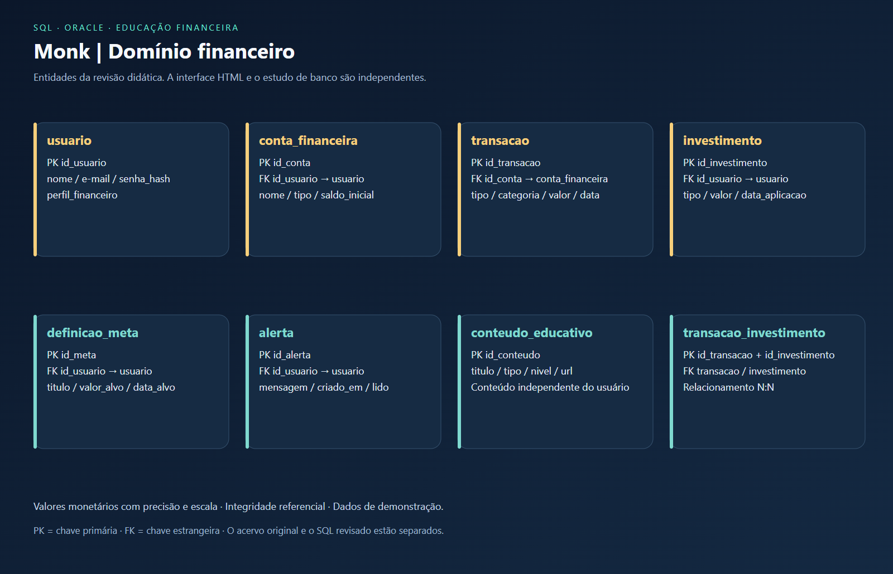

# Modelagem de dados · Monk

O acervo original está em `original`, com o `.dmd`, XML, imagem e DDL recebidos. O modelo revisado e os scripts em `database` são uma evolução didática separada. A interface HTML continua independente do banco.

## Ajustes da revisão

- Usuário usa identificador simples; o perfil financeiro é atributo, sem fazer parte da chave primária.
- Cada usuário pode possuir várias contas financeiras.
- Valores monetários têm precisão e escala; transações têm tipo e valor validados.
- A relação N:N entre transação e investimento recebeu nome explícito.
- A URL do conteúdo educativo comporta endereços completos.
- Metas possuem título e valor alvo; alertas têm estado de leitura validado.
- O campo de credencial foi definido como `senha_hash`; a amostra não autentica ninguém.

Os scripts são voltados a Oracle. A verificação local em H2 com modo Oracle é apenas uma verificação de compatibilidade parcial; não substitui executar em Oracle Database.

Consulte o [dicionário de dados](dicionario-de-dados.md) e os [scripts de banco](../../database/).
